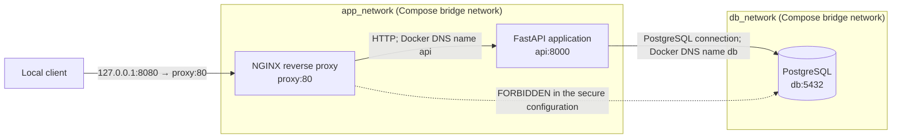

# BoundaryCheck

BoundaryCheck is a work-in-progress infrastructure security project exploring
how to verify service and network boundaries in a small containerized
application. Phase 1 provides a Docker Compose demonstration with a secure
network layout, a deliberately misconfigured comparison, and a script that
checks selected connectivity expectations.

**Current scope:** Phase 1 is an infrastructure demonstration; Phase 2 now
includes a first offline static scanner for the checked Compose topology. The
scanner evaluates normalized Compose configuration against a JSON policy. It
does not start containers or verify runtime network connectivity.

## Problem and goals

Services that do not need to communicate should not automatically have a
network path to one another. A reverse proxy that can reach a database, for
example, has broader access than the intended request flow requires. Extra
paths can increase the impact of a compromised or misconfigured component.

BoundaryCheck aims to make such boundaries easier to understand, inspect, and
verify. The current demonstration is designed to:

- show the intended proxy-to-application-to-database communication flow;
- isolate the proxy from the database with separate Docker networks;
- contrast that layout with an intentionally insecure Compose override; and
- verify selected HTTP responses, network membership, host port bindings, and
  direct TCP reachability.

These checks cover this example topology only. They are not proof that a system
is secure.

## Phase 1 functionality

The repository currently contains:

- an NGINX reverse proxy that forwards HTTP requests to a FastAPI service;
- a FastAPI `/health` endpoint and `/db-check` endpoint (`SELECT 1`);
- a PostgreSQL 16 database on a dedicated database network;
- a secure Compose configuration in which NGINX and PostgreSQL do not share a
  network, while FastAPI connects to both networks;
- an insecure Compose override that deliberately attaches NGINX to the
  database network; and
- `scripts/verify-demo.sh`, which starts isolated secure and insecure Compose
  projects, checks expected behavior, and cleans up its own containers and
  volumes.

There is no production deployment configuration or general security
assessment. The Phase 2 scanner and automated unit tests are described below.

## Phase 2.1: offline static scanner

The Python CLI checks normalized services, network memberships, and port
bindings in Docker Compose configurations against [`security-policy.json`](security-policy.json).
It detects forbidden proxy/database network sharing, checks published ports
and expected network membership, and can reject privileged containers, host
networking, and Docker socket bind mounts. The project policy enables all of
these checks. The existing insecure override fails because it attaches `proxy`
to `db_network`; the secure configuration passes.

The scanner invokes only `docker compose config --format json` and reads its
output in memory. It does not run containers, download images, or require a
running Docker Engine. Docker Compose V2 and Python 3.11 or newer must be
installed. Compose may need values for required variable interpolation. The
scanner does not write or print Compose JSON, which may contain credentials.

From the repository root in VS Code Git Bash, run:

```sh
export PYTHONPATH=src
export DB_PASSWORD=static-only-placeholder
export POSTGRES_PASSWORD=static-only-placeholder

py -3.11 -m boundarycheck scan --compose docker/compose/compose.yaml --policy security-policy.json
```

The example values satisfy Compose's required interpolation only; they are
not real credentials and are not written to a file. Alternatively, provide
the required values through your existing local environment. To scan with
one or more overrides, repeat `--compose-override`:

```sh
py -3.11 -m boundarycheck scan --compose docker/compose/compose.yaml --compose-override docker/compose/compose.insecure.yaml --policy security-policy.json
```

The first command prints `PASS`; the override command prints a `FAIL` for
the shared `db_network` and returns exit code 1. Both reports explicitly
state that runtime connectivity was not tested. Run the Python unit tests
(no Docker CLI or Engine required):

```sh
PYTHONPATH=src py -3.11 -m unittest discover -s tests -v
```

The policy engine tests use local JSON fixtures, independent of Docker
Compose. The CLI needs the Compose V2 executable to normalize actual Compose
files; if Compose is unavailable, fixture-based unit tests still run.

## Phase 2.2: security reports

The scanner supports human-readable terminal reports (the default) and
structured JSON for CI/CD. Each finding includes a stable rule ID, severity,
affected service or services, a description, rule-specific configuration
evidence, and a remediation recommendation. Exit codes are:

- `0`: the configuration passed with no policy violations;
- `1`: one or more policy violations were found; and
- `2`: the scanner could not complete because of a configuration or execution
  error.

From VS Code's Git Bash terminal at the repository root, activate the local
virtual environment and set placeholder values needed for Compose
interpolation:

```sh
source .venv/Scripts/activate
export PYTHONPATH=src
export DB_PASSWORD=static-only-placeholder
export POSTGRES_PASSWORD=static-only-placeholder
```

Scan the secure configuration with the default text report:

```sh
python -m boundarycheck scan \
  --compose docker/compose/compose.yaml \
  --policy security-policy.json
```

It reports `PASS` and returns `0`. Scan the deliberately insecure override:

```sh
python -m boundarycheck scan \
  --compose docker/compose/compose.yaml \
  --compose-override docker/compose/compose.insecure.yaml \
  --policy security-policy.json
```

It reports `BC-NET-001` because `proxy` and `db` share `db_network`, and
`BC-NET-002` because `proxy` has an unexpected network. It returns `1`.
Use `--format json` with either command to emit a JSON report to standard
output, for example:

```sh
python -m boundarycheck scan \
  --compose docker/compose/compose.yaml \
  --compose-override docker/compose/compose.insecure.yaml \
  --policy security-policy.json \
  --format json
```

The JSON report has a top-level `status`, violation count, and `violations`
array. Each finding contains `rule_id`, `severity`, `affected_services`,
`description`, `evidence`, and `remediation`. Scanner errors in JSON mode
also produce a JSON error report and return `2`.

Reports include only the service/network details needed to explain policy
findings and rule-specific evidence. They never copy Compose environment
values, labels, image values, or raw Compose output into a report. Compose
output is processed in memory. Reports state that runtime connectivity was
not tested: this is a static configuration check, not a container or network
test.

## Phase 4: additional container security checks

The three opt-in policy requirements below are enabled in
[`security-policy.json`](security-policy.json). Omit a Boolean field or set it
to `false` to disable that check for another policy. When enabled, a field must
be a JSON Boolean.

| Rule ID | Security concern | What is checked | Example violation | Recommended remediation | Known limitations |
| --- | --- | --- | --- | --- | --- |
| `BC-CONT-001` (HIGH) | Privileged mode weakens container isolation by granting broad host capabilities and device access. | `services.<name>.privileged` is exactly `true`. | `privileged: true` | Turn privileged mode off; grant only specific capabilities or devices the service needs. | Static configuration only; does not determine the impact of specific capabilities or inspect runtime state. |
| `BC-CONT-002` (HIGH) | Host networking bypasses the normal per-container Compose network namespace and network membership isolation. | `services.<name>.network_mode` is `host`. | `network_mode: host` | Use a dedicated Compose network and publish only required ports. | Does not analyze other network modes, host firewall behavior, or runtime connectivity. |
| `BC-CONT-003` (CRITICAL) | A mounted Docker daemon socket can allow extensive control over Docker resources accessible to that daemon. | A normalized bind mount whose source or target path ends in `docker.sock`. | `/var/run/docker.sock:/var/run/docker.sock` | Remove the socket mount; if API access is essential, use a narrowly scoped, authenticated proxy. | The path heuristic can flag an ordinary file with this name and miss renamed sockets, symlinks, or Windows named pipes; a finding does not prove access or exploitation. |

These are static policy findings, not claims that a configuration was
exploited. To try the examples locally, set the same harmless Compose
interpolation values shown above, then scan each override:

```sh
python -m boundarycheck scan \
  --compose docker/compose/compose.yaml \
  --compose-override tests/fixtures/compose/privileged-override.yaml \
  --policy security-policy.json
```

Replace the override path with
`tests/fixtures/compose/host-network-override.yaml` or
`tests/fixtures/compose/docker-socket-override.yaml` to test the other rules.
Each should return exit code `1` and include respectively
`BC-CONT-001`, `BC-CONT-002`, or `BC-CONT-003`. The scanner invokes only
`docker compose config`; it does not pull the example image or start a
container.

Run all unit tests with:

```sh
python -m unittest discover -s tests -v
```

## Continuous integration

### CI/CD and GitHub Actions

CI means **continuous integration**: automatically checking changes, such as
running tests, so problems are found early. CD commonly means **continuous
delivery** or **continuous deployment**. This repository's workflow provides
CI checks only; it does not publish or deploy BoundaryCheck.

GitHub Actions runs the workflow defined in
[`.github/workflows/ci.yml`](.github/workflows/ci.yml) on GitHub-hosted Ubuntu
machines. It grants only `contents: read`; checkout does not retain a GitHub
token. The workflow uses maintained major releases of `actions/checkout` and
`actions/setup-python`. The test job installs the project from `pyproject.toml`
and runs all discovered unit tests and Python compilation checks on both Python
3.11 and 3.13. Installation uses `--no-deps` because the scanner has no runtime
dependencies. A separate job validates the policy and Compose configuration,
then checks scanner exit codes and JSON results, including the expected rule
IDs for the insecure network example and separate privileged, host-network,
and Docker-socket Compose examples. Those cases are static CLI checks; CI does
not start containers or pull images.

The workflow runs automatically on every **push** and **pull request**. It
can also be started manually from the repository's **Actions** tab using
**BoundaryCheck CI → Run workflow**.

### Viewing results

1. Open the repository on GitHub and select **Actions**.
2. Select the **BoundaryCheck CI** workflow and open the run for your commit
   or pull request.
3. Open each job to see its steps. Expand a failed step to view its command
   output and error message. The test job has a separate run for each Python
   version.

A **successful workflow** means all tests and compilation checks passed on
both Python versions, the policy and secure Compose configuration were valid,
the secure scanner run returned `0`, and the insecure example returned `1`
with exactly `BC-NET-001` and `BC-NET-002`. Each of the three container
hardening examples also returned `1` with only its expected rule ID and
severity. The insecure examples are expected to produce findings, so those
steps succeed when the findings match.
This confirms the configured checks; it is not a general security
certification.

A **failed workflow** means at least one required check did not match its
expected result. Use the failed job and step to identify which check failed.

### Troubleshooting CI failures

- **Unit test failure:** Open the failing Python-version job and expand
  **Run unit tests**. The output names the failed test and includes its
  assertion or traceback. Reproduce locally with
  `python -m unittest discover -s tests -v`.
- **Package installation failure:** Inspect **Install project** for the
  packaging/build error and confirm `pyproject.toml` and package files are
  present in the commit. The step installs the package editable with
  `--no-deps`; it does not install API-container requirements.
- **Policy JSON failure:** Check that `security-policy.json` is valid JSON and
  that any changed policy still describes the intended topology.
- **Docker Compose V2 unavailable or Compose validation failure:** The job
  reports a clear error in **Check Docker Compose V2** or
  **Validate secure Compose configuration**. Review Compose YAML syntax and
  required variable interpolation. CI supplies non-sensitive placeholder
  values for `DB_PASSWORD` and `POSTGRES_PASSWORD`.
- **Secure scan fails:** The secure configuration should produce status
  `PASS`, zero findings, and exit code `0`. Review the scanner output and
  policy if a finding appears.
- **Insecure scan check fails:** The deliberately insecure example should
  return exit code `1` and report exactly `BC-NET-001` and `BC-NET-002`. If
  the scanner exits `2`, that indicates a scanner/configuration error rather
  than expected policy findings. If it exits `0`, or reports missing or
  unexpected rules, the regression check fails.
- **Container hardening example fails:** Check that the corresponding Compose
  override still normalizes and that its report contains exactly its expected
  rule ID and severity: `BC-CONT-001`/HIGH, `BC-CONT-002`/HIGH, or
  `BC-CONT-003`/CRITICAL.

The GitHub-hosted workflow uses Docker Compose V2 only to normalize and
validate configuration with `docker compose config`; it does not build
images, start containers, download images, or require a running Docker Engine.
CI interpolation uses placeholders, not production credentials. To inspect
the result of a run, use GitHub's Actions logs; a local test run does not
trigger or substitute for a GitHub-hosted run.

### Reviewing and publishing a workflow change

Review the workflow and README changes before publishing:

```sh
git diff --check
git diff -- .github/workflows/ci.yml README.md
git status --short
```

Stage only the files you intend to publish, commit them on your feature branch,
and push that branch to GitHub. For this CI change, the commands are:

```sh
git add .github/workflows/ci.yml README.md
git commit -m "Add GitHub Actions CI"
git push -u origin <your-branch>
```

Open a pull request on GitHub to review the change and watch its Actions checks.
After the pull request is approved, merge it using your repository's normal
process. No workflow in this repository automatically pushes or deploys code.

## Architecture



The solid arrows are intended communication paths. The dotted line identifies
the direct proxy-to-database path that must not exist in the secure
configuration; it is demonstrated by the insecure override. The host publishes
only NGINX, bound to loopback. See [Architecture and design decisions](docs/architecture.md)
and [Docker networking guide](docs/networking.md) for more detail.

## Technologies

- **Docker Compose V2** to define and run the local multi-container environment.
- **NGINX 1.28 Alpine** as the HTTP reverse proxy.
- **Python 3.12**, **FastAPI**, and **Uvicorn** for the API container; the
  offline scanner itself uses only Python's standard library.
- **psycopg 3** for the API's PostgreSQL connection.
- **PostgreSQL 16 Alpine** for the database.
- **Bash**, **Docker CLI**, and **curl** for the infrastructure verification
  script.
- **Setuptools** for Python package metadata and build configuration. The
  package currently has no installed CLI entry point.

## Prerequisites

For the containerized application:

- Git;
- Docker Desktop (Windows/macOS) or Docker Engine (Linux);
- Docker Compose V2 (`docker compose`, not the legacy `docker-compose`); and
- a running Docker daemon.

To execute the verification script, also have Bash and `curl`. On Windows, run
it from Git Bash or WSL with access to the Docker daemon. The script uses the
Docker CLI and Compose V2.

Python 3.11 or newer is needed to run the BoundaryCheck scanner and tests.
Docker Compose V2 is needed to scan actual Compose files, but a running Docker
Engine is not. The API itself runs in its Docker image.

## Get the project and configure it

Clone the repository using its GitHub URL, then change to the checkout
directory:

```sh
git clone REPOSITORY_URL
cd Check-Boundary
```

Replace `REPOSITORY_URL` with the clone URL for this repository.

The checked-in `.env.example` contains public development-only placeholders.
Copy it to `.env` before starting Compose. Review the values and replace them
for your local development environment:

```powershell
Copy-Item .env.example .env
```

```sh
cp .env.example .env
```

`.env` is a plain-text local configuration file, not a secret manager. The
example values are public placeholders and are not safe for production. Do not
put production credentials in this file or commit real secrets.

Optional Python package-development setup (from the repository root):

```powershell
py -3.11 -m venv .venv
.\.venv\Scripts\python.exe -m pip install -e .
```

```sh
python3 -m venv .venv
.venv/bin/python -m pip install -e .
```

The editable install exposes the `boundarycheck` command and does not install
the API's separate runtime requirements. The scanner can instead be run
directly with `PYTHONPATH=src py -3.11 -m boundarycheck`, without installing
the package.

## Start the secure environment and run the application

From the repository root, build and start the secure Compose stack:

```sh
docker compose --env-file .env -f docker/compose/compose.yaml up --build -d
```

Compose starts NGINX, FastAPI, and PostgreSQL. NGINX is available only on the
host loopback interface at `http://127.0.0.1:8080`; the API and database ports
are not published on the host.

Check that requests pass through NGINX to FastAPI and that the API can query
PostgreSQL:

```sh
curl http://127.0.0.1:8080/health
curl http://127.0.0.1:8080/db-check
```

Expected response bodies:

```json
{"status":"ok"}
```

```json
{"status":"ok","database":"connected","query_result":1}
```

On Windows PowerShell, `Invoke-RestMethod` is also available:

```powershell
Invoke-RestMethod http://127.0.0.1:8080/health
Invoke-RestMethod http://127.0.0.1:8080/db-check
```

## Start the intentionally insecure configuration

Stop the secure stack first because both configurations bind the same host
address and port:

```sh
docker compose --env-file .env -f docker/compose/compose.yaml down
docker compose --env-file .env -f docker/compose/compose.yaml -f docker/compose/compose.insecure.yaml up --build -d
```

The override adds `proxy` to `db_network`, giving NGINX a direct network path
to PostgreSQL. This configuration exists only to demonstrate a boundary
violation. Do not use it as a deployment configuration.

Stop it when finished:

```sh
docker compose --env-file .env -f docker/compose/compose.yaml -f docker/compose/compose.insecure.yaml down
```

## Run the infrastructure verification

With Bash, Docker Compose V2, `curl`, and a running Docker daemon, execute this
from the repository root:

```sh
bash scripts/verify-demo.sh
```

The script runs the secure and insecure projects sequentially because both
publish `127.0.0.1:8080`. It verifies readiness, proxy HTTP forwarding, the
database query, absence of host-published API/database ports, proxy membership
in `db_network`, and a direct TCP probe to PostgreSQL from the proxy's network
namespace. It uses unique Compose project names and removes only its own
containers and demo volumes on exit. A failed check produces a nonzero exit
status.

Illustrative output shape (not a report of a run performed for this README):

```text
BoundaryCheck Phase 1 Step 6 infrastructure verification

=== secure environment (...) ===
PASS: proxy, api, and db are running; configured health checks are healthy.
PASS: NGINX forwards /health to FastAPI.
PASS: FastAPI /db-check successfully queries PostgreSQL (SELECT 1).
PASS: secure proxy is not connected to ..._db_network.
PASS: FastAPI has no host-published ports.
PASS: PostgreSQL has no host-published ports.
PASS: direct TCP connection from secure proxy to PostgreSQL is blocked (...)

=== insecure environment (...) ===
PASS: insecure proxy is connected to ..._db_network.
INFO: This violates the intended isolation policy: NGINX now shares a network with PostgreSQL and has a direct network path to its port.
PASS: direct TCP connection from insecure proxy to PostgreSQL succeeds (...)

RESULT: PASS — all secure and insecure demonstration checks passed.
```

Actual output includes additional checks and unique project/network names.
`PASS` means an expected condition was observed, including the expected
reachability in the deliberately insecure case. The final result is meaningful
only for the checks performed; it does not certify the host or deployment.
For the probe details and limitations, see the
[verification guide](scripts/verify/README.md).

If a check fails, the script reports the check and a nonzero summary, for
example (illustrative output, not a recorded run):

```text
FAIL: FastAPI /db-check successfully queries PostgreSQL (SELECT 1). (request failed or response did not contain ...)
RESULT: FAIL — 1 check(s) failed.
```

## Stop containers and clean up

Stop the secure stack without removing its database volume:

```sh
docker compose --env-file .env -f docker/compose/compose.yaml down
```

Stop the insecure stack with both Compose files:

```sh
docker compose --env-file .env -f docker/compose/compose.yaml -f docker/compose/compose.insecure.yaml down
```

Add `--volumes` to the matching `down` command only if you also want to delete
the `postgres_data` named volume and its local database contents. The
verification script always deletes its own temporary demo volumes.

## Known limitations

- The project checks a fixed local Compose example; it does not discover or
  assess arbitrary Docker environments.
- The verifier checks selected network membership, one direct TCP destination,
  two HTTP endpoints, and host port bindings. It does not inspect every route,
  port, protocol, container permission, vulnerability, or policy.
- A failed TCP probe is not proof of security, and the insecure demonstration
  is not a production threat model.
- The API uses development placeholder credentials from `.env.example`.
  There is no production secret-management, TLS, API client authentication,
  or hardening configuration.
- PostgreSQL creates a non-superuser application role on first initialization.
  Its init SQL is not rerun for an existing `postgres_data` volume; an existing
  local database needs a deliberate role migration before using this
  configuration.
- NGINX forwards HTTP, and its published host port is restricted to loopback;
  this is a local demonstration, not a production ingress design.
- PostgreSQL data persists in a named volume unless it is explicitly removed.
- Container image tags and Python dependency ranges are not pinned to immutable
  digests or a lockfile, so artifacts may change between builds.
- The scanner checks normalized Compose configuration, not actual running
  networks, firewall behavior, or runtime connectivity. A passing scan is not
  proof that a deployment is secure.
- The API container runs as a non-root user with a read-only root filesystem
  and dropped Linux capabilities. These controls are configured for this
  container; they do not replace broader host and deployment security.
- NGINX and PostgreSQL retain their image-default runtime identities and
  capabilities. The proxy has not been migrated to an unprivileged NGINX
  image, so container-level least-privilege hardening is not uniform across
  services.

## Future roadmap

The first Phase 2 scanner is intentionally limited to Compose network
membership and selected host-port rules. Further development should:

- define supported inputs and policy semantics before broadening assessments;
- report evidence and uncertainty rather than treating static analysis as
  runtime verification;
- add automated tests for implemented logic and repeatable integration checks;
- document permission requirements, limitations, and safe execution.
