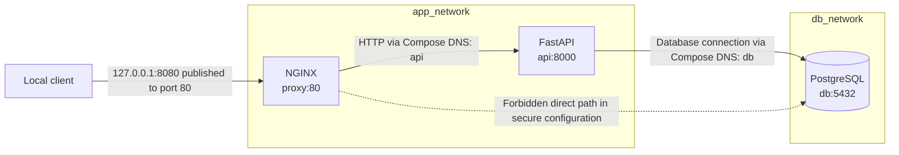

# Architecture and design decisions

BoundaryCheck Phase 1 is a local Docker Compose demonstration of a three-tier
request path and a network boundary. The only intended application flow is:

1. A local client sends HTTP to NGINX on the host's loopback address,
   `127.0.0.1:8080`.
2. NGINX forwards the request to FastAPI at `api:8000` over `app_network`.
3. For `/db-check`, FastAPI connects to PostgreSQL at `db:5432` over
   `db_network`.

The API is attached to both networks because it is the application component
that must communicate with both the proxy and the database. NGINX is attached
only to `app_network`; PostgreSQL is attached only to `db_network`.

The dotted edge is a policy statement, not a connection in the secure
configuration. `compose.insecure.yaml` deliberately changes the topology by
also attaching `proxy` to `db_network`, then the verification script probes
whether that changed network membership corresponds to TCP reachability.

## Why these technologies?

### Docker Compose

Compose defines the services, image builds, dependencies, health checks,
networks, and persistent database volume in version-controlled YAML. It makes
the example straightforward to recreate with a small set of commands and
provides an override file for demonstrating one narrowly scoped network
misconfiguration. Image tags and Python dependency ranges are not immutable
pins, so the build is not bit-for-bit reproducible.

Compose is used here as a local development and verification tool. It is not a
claim that this stack is orchestrated or secured for production.

### NGINX

NGINX is the only service with a host-published port. It accepts HTTP on
container port 80 and forwards requests to `api:8000`. This provides a concrete
reverse-proxy boundary to examine: the proxy should reach the application, but
it has no need to connect directly to PostgreSQL.

The current NGINX configuration is a simple HTTP proxy configuration. TLS,
production ingress controls, and additional hardening are outside this
demonstration's scope.

### FastAPI

FastAPI provides two small endpoints that make the service path observable:

- `GET /health` returns an application health response.
- `GET /db-check` opens a PostgreSQL connection and executes `SELECT 1`.

The API is attached to `app_network` and `db_network`. In Compose, it reaches
the other services by their service names (`api` and `db`) and their
container-side ports. Its container port 8000 is not published on the host.
The image runs the API as a non-root user; Compose also makes its root
filesystem read-only, drops Linux capabilities, and enables
`no-new-privileges`.

### PostgreSQL

PostgreSQL supplies a real database endpoint for demonstrating a permitted
application-to-database connection and an unintended proxy-to-database
connection. It listens on its container network at port 5432 and has no host
port binding in the Compose configuration. Its data is kept in the
`postgres_data` named volume. The image's bootstrap `postgres` account is kept
separate from the application's login. An initialization script creates the
application role with `NOSUPERUSER`, `NOCREATEDB`, `NOCREATEROLE`, and
`NOREPLICATION`, then grants it database connection access. The script runs
only when PostgreSQL initializes an empty data directory.

The credentials in `.env.example` are public development placeholders. A real
deployment needs an appropriate secrets-management and access-control design.

### Separate Docker networks

`app_network` and `db_network` are separate Compose bridge networks. The proxy
and API share the application network; the API and database share the database
network. This gives the intended services a direct network path while omitting
the proxy's direct network attachment to the database.

This reduces unnecessary connectivity in the example, but it does not
establish a complete security boundary. In particular, the API is
dual-homed, Docker's host administrator can inspect or change network
attachments, and the verifier exercises only selected connectivity.
See the [networking guide](networking.md) for details.

### Automated connectivity verification

`scripts/verify-demo.sh` runs both Compose variants with unique project names.
It checks service readiness, HTTP responses, the database query, host port
bindings, proxy membership in the database network, and TCP reachability to
PostgreSQL from the proxy's network namespace.

Testing the secure and insecure layouts side by side helps show which observed
behavior changes when the proxy is attached to `db_network`. The script is a
focused demonstration, not a general network scanner or a security
certification. A test result applies only to the checks made, at the time they
were made.

### Offline static scanner

The scanner normalizes Compose files with `docker compose config --format
json` and checks service network memberships, selected published-port rules,
and optional container-hardening requirements from a JSON policy. These
include privileged mode, host networking, and Docker socket bind mounts. This
observes declared configuration only. It neither starts containers nor checks
runtime connectivity, and its findings do not replace the Phase 1
connectivity verification.

## Related implementation

- Secure and insecure service definitions: [`docker/compose/compose.yaml`](../docker/compose/compose.yaml)
  and [`docker/compose/compose.insecure.yaml`](../docker/compose/compose.insecure.yaml).
- Proxy forwarding rule: [`docker/nginx/default.conf`](../docker/nginx/default.conf).
- API endpoints: [`src/boundarycheck/api.py`](../src/boundarycheck/api.py).
- Connectivity verifier: [`scripts/verify-demo.sh`](../scripts/verify-demo.sh).
- Static scanner: [`src/boundarycheck/scanner.py`](../src/boundarycheck/scanner.py)
  and [`security-policy.json`](../security-policy.json).
